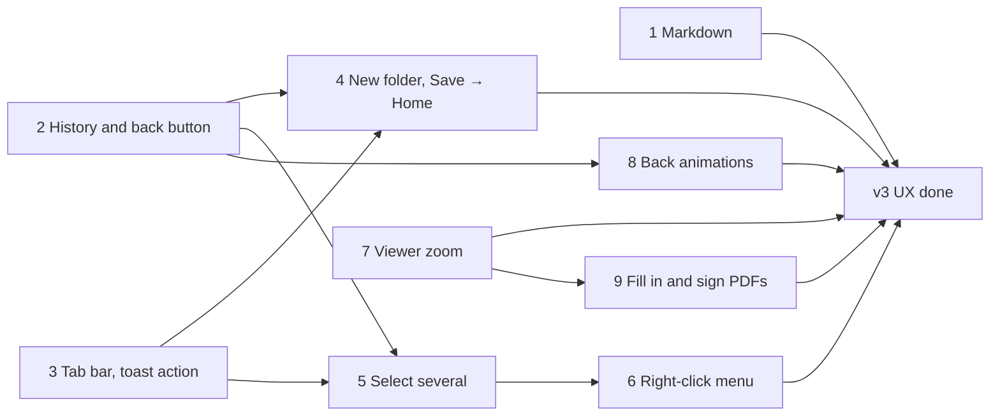

# v3 usability: work plan

The nine "easier to use" items of the [v3 roadmap](roadmap.md#v3), as they were chosen on 2026-11-13 from the options in [`homedrive-mockup/v3-options.html`](../homedrive-mockup/v3-options.html). What to build is described in [`architecture.md`](architecture.md); this file is the order to build it in, what each step touches and when it is done. Work happens on `v3/development`.

| # | Item | Chosen | Design |
|---|---|---|---|
| 1a | Markdown preview in the viewer | B: page with a *Page \| .md* switch | [Markdown preview and page editing](architecture.md#markdown-preview-and-page-editing-v3) |
| 1b | Page editing for a file that would be rewritten | A: short question | same |
| 2 | Back animations | A: zoom back | [Back animations](architecture.md#back-animations-v3) |
| 3 | New folder while saving from the share sheet | A: name it in the list; then Home | [New folder in the folder picker](architecture.md#new-folder-in-the-folder-picker-v3) |
| 4 | + covers ⓘ on phones | B: + in the tab bar | [Phone navigation](architecture.md#phone-navigation--in-the-tab-bar-v3) |
| 5 | Select several | B: actions in a bottom bar | [Selecting several items](architecture.md#selecting-several-items-v3) |
| 6 | Zoom in the viewer | B: gestures and a zoom bar | [Viewer zoom](architecture.md#viewer-zoom-v3) |
| 7 | Back button in the installed app | A: ask in a sheet | [Back button and history](architecture.md#back-button-and-history-v3) |
| 8 | Right-click menu | A: classic list with shortcuts | [Right-click menu](architecture.md#right-click-menu-v3) |
| 9a | Filling in a PDF | A: toolbar, tap to place | [Fill in and sign PDFs](architecture.md#fill-in-and-sign-pdfs-v3) |
| 9b | Making the signature | B: draw or type | same |
| 9c | Keeping the signature | A: with the account | same |
| 9d | Saving a filled-in PDF | A: new version of the file | same |

## Order

WP1, WP2, WP3 and WP7 don't depend on each other. WP2 comes early because WP4, WP5 and WP8 build on it; WP9 reuses WP7's page view and zoom. Each work package is one feature release (`3.Y.0`, see *Releasing* in the [README](../README.md)), with its changelog entry; how they interleave with the other v3 items (restore, app name, emails, notifications) is open.

The empty-line bug in WP1 is in the released 2.7.0. Its fix (the first bullet of WP1) can ship alone as 2.7.1 from `main` if that is wanted before v3.

## Rules for every work package

- English and Dutch strings for everything new (`web/src/i18n/en.ts`, `nl.ts`), in the copy style of the [design handoff](../homedrive-mockup/README.md#copy-rules) (Title Case buttons and dialog titles, sentence case text).
- Accessibility as in the handoff's checklist: real buttons, `aria-label`s, focus kept and given back, Esc closes, nothing only by colour or only by gesture. Motion off with `prefers-reduced-motion`.
- `npm run typecheck`, `npm test` and `npm run build` in `web/`; `go vet ./...` and `go test ./...` in `server/`.
- Try it on: Android Chrome as installed app and as a tab, iPhone Safari from the home screen and as a tab, desktop Chrome, Firefox and Safari.
- When something in the design turns out not to work, change `architecture.md` in the same pull request.

## WP1 · Markdown preview and page editing

Web only.

- **Empty lines.** In `web/src/editor/MarkdownEditor.tsx`, extend the paragraph so an empty paragraph is written as `&nbsp;` (with `@tiptap/markdown`'s `renderMarkdown` on `Paragraph.extend`). Checked while planning: `A\n\n&nbsp;\n\nB` lexes as three text paragraphs (no `html` token) and parses back to `[A, empty, B]`; today an empty paragraph is written as `A\n\n\n\nB` and read back as `[A, B]`.
- **`pageUnsafe`** in `web/src/editor/session.ts` becomes an allowlist of the token types the page editor has a node or mark for (`paragraph`, `heading`, `list`, `list_item`, `blockquote`, `code`, `hr`, `space`, `text`, `strong`, `em`, `codespan`, `br`, `link`, `escape`); anything else (`html`, `image`, `table`, `del`, footnotes …) blocks the page, with its kind as the reason.
- **Switch question.** Split the editor's `forced` mode in two: `tidy` (only `sameMarkdown` fails: *Page* asks with a `Modal`, *Stay In .md* / *Switch*) and `blocked` (`pageUnsafe`: *Page* disabled, the reason in the note and the tooltip). The page editor must not save on load: check that mounting with the file's text triggers no `update`.
- **Preview.** New `web/src/components/MarkdownPreview.tsx`: marked's lexer (add `marked` to `package.json` at the version `@tiptap/markdown` uses) and a token → React renderer. Headings, paragraphs, emphasis, inline code, code blocks, lists and task lists, quotes, rules, line breaks, GFM tables, strikethrough; links through `safeUrl` with `target="_blank" rel="noopener noreferrer nofollow"`; raw HTML as text; images as alt text plus address, never loaded. Lazy-loaded like `PdfView`.
- In `web/src/components/Viewer.tsx`: `.md` files use the preview, with the *Page | .md* switch in the bar (`localStorage` `hd.mdView`); *.md* is today's `TextPreview`. On phones *Download* moves into the info drawer. Share the page typography with `styles/editor.css` (one class for the editor page and the preview).
- **Tests** (`web/test/`): a property test that builds random documents from the supported nodes and checks `serialize(parse(serialize(doc))) === serialize(doc)` and `pageSafe` (the MarkdownManager works without a DOM, as in the check above); `pageUnsafe` cases per token type; the preview rendered with `react-dom/server` for `javascript:` links, raw HTML, images and tables.
- **Done when:** a new document with empty lines typed on the page reopens on the page; a file with `*` bullets asks, then opens on the page and saves only after a change; a file with a table keeps *Page* disabled and says why; the viewer shows `.md` formatted and remembers the switch.

## WP2 · History and the back button

Web only. The foundation for WP4, WP5 and WP8.

- `web/src/router.ts`: the history model of the design: `history.state.hd = {i, kind, from}`, the trail of paths in `sessionStorage`, and `navigate(path, {replace})`, `back(n)`, `goUp(target)` (back when the target is the previous entry, else replace), `goTop(path)` (back to Home, then push unless Home). Launch rewrite and the Home guard only when `display-mode: standalone` or `navigator.standalone`.
- New `useBackLayer(open, close)` (next to the router). Use it in `Modal` (`components/Dialogs.tsx`), the info sheet on phones (`InfoPanel.tsx`), the account popover (`Shell.tsx`), `Select.tsx` and the drive menus (`Drives.tsx`), the viewer (`ItemActions.tsx`) and the editor (`editor/Editor.tsx`: back runs `close()`; *Keep editing* pushes the layer again).
- *← Back*, breadcrumbs and the rail (`components/Items.tsx`) use `goUp`; the tab bar, sidebar sections, logo, Account and Storage use `goTop`.
- The *Close Homedrive?* sheet (new, in `App.tsx`): *Stay*, tap outside or 4 s push the guard again.
- **Tests:** `web/test/history.test.ts` against a fake `History` (asynchronous `popstate` like browsers): the simulator's scenarios in the mockup (app icon, share sheet, notification; layers; in-page Back; tabs never growing the history; two backs on Home leave).
- **Done when:** the scenarios behave as in the simulator on Android (installed); in a desktop tab, back closes the viewer and dialogs and otherwise works as before; login and setup redirects still replace.

## WP3 · + in the tab bar, Trash in the account menu

Web only.

- `components/Shell.tsx`: `TabBar` becomes Files, Shared, +, Recent, Starred, with `onAdd` and a reason when adding isn't possible; `Fab` goes. The account menu gets *Trash* with its count, shown on phones only.
- `pages/Browser.tsx`: pass `canAdd`, the reason and `onAdd` to the tab bar.
- `styles/app.css`: the + tab, no `.fab`, the end-of-list padding for tab bar, toast and safe area, the toast just above the tab bar.
- `components/Toast.tsx`: a general action `{label, run}` next to *Undo* (used by WP4 and WP5).
- **Done when:** on a 360 × 640 phone, at the end of a long folder, every card's ⓘ can be tapped; the + is dimmed and explains itself in Recent, Starred, Shared with me and viewer drives; Trash is in the account menu with its count.

## WP4 · New folder in the picker, Home after saving

Web only. Needs WP2 (`goTop`) and WP3 (toast action).

- `components/Dialogs.tsx` `FolderPicker`: *New Folder* next to the folder's name (not for viewers), the inline row with the name selected, `api.createFolder`, then open the new folder in the picker; Esc drops the row; errors under the field. `MoveDialog` gets it through the picker.
- `pages/Save.tsx`: after the last pending share is saved without failure and nothing waits for an answer, `goTop('/')` and the toast "Saved in <path>" with *Open* (`hrefFor` the folder). Keep the page as it is on failure or a pending *Replace / Keep both*.
- **Done when:** sharing photos from the Android gallery, making a folder in the picker and saving ends on Home with the toast, and back from there asks to close; *Move* can make a folder too.

## WP5 · Select several

Server and web. Needs WP2 (back clears the selection) and WP3 (the tab bar is replaced while selecting).

- **Server**
  - `POST /api/nodes/batch` (new `server/internal/server/batch_handlers.go`): validate `op`, at most 500 IDs, recent password for `delete`; per item call the same `files` function as the single endpoint (`Move`, `Trash`, `Restore`, the star update of `PATCH /api/nodes/{id}`, `DeleteForever`) and the same audit event; collect `{done, skipped: [{id, code}]}` with the codes `s.fail` would give.
  - Zips: `files.Archive` takes a list of roots (`ArchiveMany`), `WriteZip` writes each root at the top level with `(2)` for equal names, the name rule of the design. `POST /api/zips` stores `{user, session, archive, expires}` under a 128-bit token in memory (2 minutes, single use, a cap per user); `GET /api/zips/{token}` checks user and session, then streams like `handleZip` with the same per-user gate. `logPath` shows the token as `…`.
  - **Tests:** the access matrix from the v2 gate over both endpoints (viewer skipped, *Can edit* recipient can't delete forever or move out of the share, moving into its own subtree, trashed items), 500-ID cap, recent password; zip tokens single use, other user and other session 404, expiry, equal names.
- **Web**
  - New `web/src/selection.ts`: selection state (ids, anchor; toggle, range, all, clear), cleared on navigation, a back layer while not empty.
  - `components/Items.tsx`: check circles on cards and rows, Ctrl/⌘ and Shift clicks, long-press on touch (500 ms, cancelled by moving, `navigator.vibrate` where supported).
  - New `components/SelectionBar.tsx`: the count with *Select all* and ✕ on top, the labelled actions at the bottom (phone: in place of the tab bar; computer: floating).
  - `pages/Browser.tsx`: selection in `FolderView`, `LocatedView`, `SharedView` and `TrashView`; *Move* through `MoveDialog` with a list; toasts with done and skipped counts and *Undo*.
  - `api.ts`: `batch()` and `zipMany()` (open the returned URL as a download).
  - **Tests:** `web/test/selection.test.ts` for toggle, range from the anchor, select all and clearing.
- **Done when:** on a phone, long-press then taps select, back clears; on a computer Ctrl/Shift-click and Ctrl+A work; moving 30 photos is one action; a mixed selection with view-only items says how many were skipped; downloading several gives one `.zip`.

## WP6 · Right-click menu and shortcuts

Web only. Needs WP5.

- New `components/ContextMenu.tsx` (`role="menu"`, roving focus, arrow keys, Home/End, Enter, Esc, flips inside the window, focus given back, a back layer).
- New `web/src/itemMenu.ts`: the entries for one item, a selection, empty space, Trash and link pages, built from the same action functions as the info panel and the selection bar.
- `components/Items.tsx` and the views in `pages/Browser.tsx`: `onContextMenu` on items and on the empty file area (not in inputs, the editor or the viewer); ignore it after a touch `pointerdown` (Android fires it on long-press).
- Shortcuts in the file list: Enter, F2, Delete (with *Undo*), Alt+Enter, Ctrl/⌘+A, Esc, Shift+F10 and the menu key.
- **Tests:** `web/test/itemMenu.test.ts`: which entries show for each role, for a share root, in Trash and on link pages.
- **Done when:** every action of the info panel can be done from the menu and by keyboard; nothing the user can't do appears; long-press on Android still selects.

## WP7 · Zoom in the viewer

Web only. Independent.

- New `web/src/zoom.ts` with the pure math (clamp, zoom at a point, pinch from two pointers, double-tap target, fit) and `components/ZoomStage.tsx` (pointer events, Ctrl + wheel, double-tap/click, keys `+ − 0`, `touch-action`, iOS `gesturestart`/`gesturechange` cancelled) with the zoom bar.
- `components/Viewer.tsx`: photos in a `ZoomStage`; swipe left/right at fit for previous/next on phones; the bar hides after 3 s on phones.
- `components/PdfView.tsx`: CSS scale during a gesture, re-render of the visible pages 150 ms after it stops at `fit × zoom × devicePixelRatio`, at most 16 MP per canvas, scroll anchored at the pinch point, scrolling both ways; page number in the bar.
- Text, code and Markdown: text size 50–300% through a CSS variable, kept while the viewer is open.
- **Tests:** `web/test/zoom.test.ts` for the math (no drift when zooming in and out at the same point, clamping at the edges, limits).
- **Done when:** pinching in the viewer on Android and iPhone zooms only the photo or PDF while the bar stays; a PDF is sharp at 300%; swipes go to the next photo at fit; page zoom still works elsewhere.

## WP8 · Back animations

Web only. Needs WP2.

- `web/src/router.ts` tells `web/src/motion.ts` the direction of a navigation and the folder it came from; drop the 2-second window.
- `motion.ts`: zoom back in grid view on every way back; list view in both directions (name into the rail and back; rows only fade below 1100 px); a cache of the last 10 folder views (details and items per sort) that `FolderView` (`pages/Browser.tsx`) draws at once and refreshes in the background.
- `components/Viewer.tsx` and `components/ItemActions.tsx`: open from and close into the card's thumbnail (look it up by `data-node`), fade when it isn't on screen; keep the viewer mounted until its closing animation ends.
- `editor/Editor.tsx`: closing slides down 40 px and fades.
- **Done when:** the hardware back button, *← Back*, breadcrumbs and the rail all play the zoom back in grid and list view; a photo shrinks back into its card; nothing moves with reduced motion; going back never waits for the network.

## WP9 · Fill in and sign PDFs

Server and web. Needs WP7 (the PDF page view with zoom). Uses WP2's back layers once it is there.

- **Start:** pick the PDF writer: `@cantoo/pdf-lib` (maintained fork of pdf-lib) with `@pdf-lib/fontkit`; check its license, bundle size (lazy-loaded) and that it fills and flattens the AcroForm field types and embeds an Inter subset. Pick the handwriting font (OFL, about 50 KB) and add it with its license under `web/public/fonts/`.
- **Server**
  - A new migration `server/internal/db/migrations/00NN_signatures.sql` (the next free number) and the handlers `GET /api/me/signatures`, `PUT /api/me/signatures/{kind}`, `DELETE …` (next to the other `/api/me` routes in `account_handlers.go`): `image/png` only, at most 256 KB, decoded with `image/png` to check it is a PNG of at most 1600 × 600, `Cache-Control: no-store`, audit events.
  - `POST /api/uploads` (`files_handlers.go`, `files/uploads.go`): optional `replaceId` and `ifVersion` with `X-Lock-Id`; check edit rights, the lock and the version when the upload is created and again on completion; answer `lock_lost` / `edit_conflict` like `PUT /api/nodes/{id}/content`; the result is a new version of `replaceId` (the v2 *Replace* path), audited as `upload.replace`.
  - **Tests:** signatures only for their owner, size and dimension limits, a non-PNG refused; the replace upload with a wrong lock, a stale `ifVersion`, someone else's lock, a viewer, a file trashed meanwhile.
- **Web**
  - New `web/src/pdf/` (lazy-loaded): `FillSign.tsx` (full screen, reusing `PdfView` and the zoom stage, an overlay for fields from `page.getAnnotations()` and for placed items, the toolbar, undo/redo, close with *Save / Discard / Keep editing*), `place.ts` (placed items in PDF points per page: add, move, resize, delete; rotation; pure and tested), `write.ts` (fill fields, draw items, embed PNGs, flatten), `SignatureSheet.tsx` (Draw pad with smoothing and speed-based width, Type with the handwriting font, both to PNG; saved signatures from the API).
  - `components/Viewer.tsx`: *Fill & Sign* for PDFs, taking the lock for people who can edit (the existing `EditButton` logic); read-only notes for password, XFA, signed, too large.
  - Saving: editors upload through `uploads.ts` with `replaceId`, `ifVersion` and the lock, then the viewer shows the new version; on `edit_conflict` offer *Save as a copy*. Viewers save `<name> (filled in|signed).pdf` in My Files.
  - `pages/Account.tsx`: a *Signature* section showing the saved signature and initials, with *Replace* and *Delete*.
  - Date in the user's language format; English and Dutch strings.
  - **Tests:** `web/test/pdfPlace.test.ts` for coordinates (zoom, page rotation 90/180/270, resizing limits); `web/test/pdfWrite.test.ts` filling a small test PDF with text, check box and radio fields, placing items and flattening, then reading it back with pdf.js (no fields left, text present).
- **Done when:** a government form with fields is filled in and signed on an Android phone and on a computer; a scanned PDF without fields gets text, a date and a signature placed; the signature drawn on the phone is offered on the computer; the empty form is in *Versions* after saving; a viewer of a shared PDF saves a filled-in copy in My Files; a password-protected PDF opens read-only with a note.

## When all are done

- Update the [roadmap](roadmap.md#v3) status and the README table.
- Add these surfaces to the v3 release security check when it is written: the batch endpoint, zip tokens, signature storage and the replace upload in the access-control matrix, the Markdown preview in the XSS checks, hostile PDFs in *Fill & Sign* (see [`security.md`](security.md#selections-zips-markdown-preview-and-signatures-v3)).
